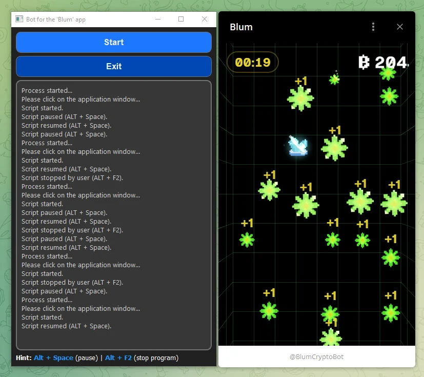

# bot_blum_game

Настольный инструмент компьютерного зрения для взаимодействия с игровым окном. Он захватывает выбранную область экрана, находит объекты обученными детекторами dlib и переводит координаты найденных элементов в координаты клика.

**Python-портфолио Евгения Толмачева** · Python · PyQt5 · dlib · mss · NumPy · pynput



## Возможности

- Позволяет выбрать целевое окно и управлять запуском, паузой и остановкой обработки.
- Получает кадры окна через mss и подготавливает RGB-изображения для распознавания.
- Использует отдельные детекторы игровых объектов и кнопок интерфейса.
- Выполняет клики по найденным координатам и выводит сообщения о работе в интерфейсе.

## Как устроен проект

### Окно управления

[`bot_blum_game.py`](bot_blum_game.py)

MainWindow создаёт интерфейс, выбирает целевое окно и управляет состоянием фонового процесса.

### Захват и распознавание

[`bot_blum_game.py`](bot_blum_game.py)

capture_and_process получает кадры, а process_image преобразует изображение и вызывает детекторы объектов.

### Управление вводом

[`bot_blum_game.py`](bot_blum_game.py)

Координаты детекций переводятся в экранные координаты; mouse_click и обработчики клавиатуры управляют кликами и паузой.

## Технологии и их роль

- **PyQt5**: Окно управления и журнал сообщений.
- **mss, NumPy и Pillow**: Захват экрана и подготовка изображения для обработки.
- **dlib**: Распознавание объектов с помощью сохранённых SVM-детекторов.
- **pynput, WinAPI и потоки**: Обработка ввода, клики и фоновый цикл обработки кадров.

## С чего начать просмотр кода

В bot_blum_game.py последовательно прослеживаются выбор окна, захват кадра, распознавание и действие. Для запуска распознавания нужны соответствующие файлы моделей SVM.

## Подготовка и запуск

Создайте отдельное окружение и установите исходные зависимости:

```powershell
python -m venv .venv
.venv\Scripts\Activate.ps1
python -m pip install -r requirements.txt
```

Проект ориентирован на Windows. Модели flower_detector.svm, invite_detector.svm и play_detector.svm в исходниках упоминаются, но не включены. Приложение управляет мышью/клавиатурой, поэтому перед включением автоматизации проверьте область захвата и настройки.

После подготовки настроек и необходимых данных основная точка входа:

```powershell
python bot_blum_game.py
```

`requirements.txt` сохранён из проекта. Это снимок окружения, а не гарантия совместимости с новейшей версией Python. Для старых проектов могут потребоваться соответствующая версия Python и настройка системных компонентов.

## Структура

```text
bot_blum_game/
├── docs/
│   └── preview.webp
├── .gitignore
├── bot_blum_game.py
├── README.md
└── requirements.txt
```

## Контекст и ограничения

Проект 2024 года на стыке настольного интерфейса и компьютерного зрения. В представленной версии распознавание основано на моделях dlib в формате SVM. Основная инженерная задача - связать захват экрана, обработку кадров и управление вводом.

Проверены синтаксис Python-файлов и состав публикации. Полный запуск этой версии с внешними сервисами, локальными данными или моделями не выполнялся; команды выше описывают подготовку по исходникам.

## Состав репозитория

Сохранены авторские исходники, их имена и структура, зависимости и компактный скриншот. Рабочие базы, наборы данных, модели и виртуальные окружения исключены. Секреты заменены обозначениями `YOUR_...` / `REDACTED_...`; реальные значения задаются локально. Исходные алгоритмы при оформлении портфолио не перерабатывались.

Автор: [Евгений Толмачев](https://github.com/EvgenyET) · [Портфолио](https://evgeny.tech/)
